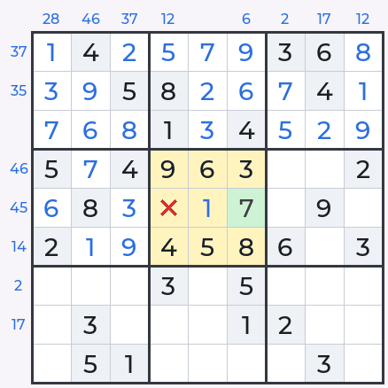

<!-- Written by tools/walkthrough.py next-to-nine: edit the script, not this page. -->
# Next to Nine, step 26: the 7 in box 5

**Step 26 of 51** · [← Step 25](step-25.md) · [All steps](../next-to-nine.md#the-whole-puzzle-step-by-step) · [Step 27 →](step-27.md)

Box 5 needs a 7. r5c4: it's beside the 9 in column 4, whose clue lists 1 or 2. Only **r5c6** is left: **r5c6 = 7**.

**Step 26 of 51** · [← Step 25](step-25.md) · [All steps](../next-to-nine.md#the-whole-puzzle-step-by-step) · [Step 27 →](step-27.md)
