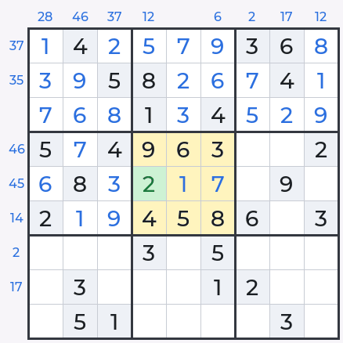

<!-- Written by tools/walkthrough.py next-to-nine: edit the script, not this page. -->
# Next to Nine, step 27: the 2 in box 5

**Step 27 of 51** · [← Step 26](step-26.md) · [All steps](../next-to-nine.md#the-whole-puzzle-step-by-step) · [Step 28 →](step-28.md)

Box 5 needs a 2, and r5c4 is its last empty cell: **r5c4 = 2**.

**Step 27 of 51** · [← Step 26](step-26.md) · [All steps](../next-to-nine.md#the-whole-puzzle-step-by-step) · [Step 28 →](step-28.md)
