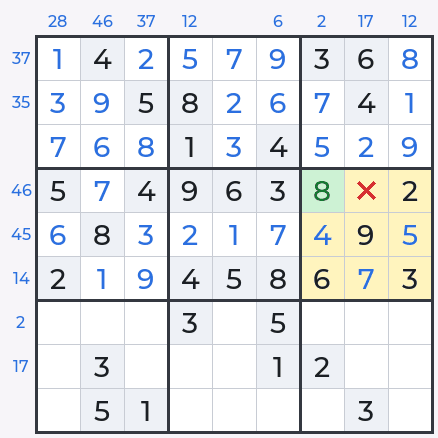

<!-- Written by tools/walkthrough.py next-to-nine: edit the script, not this page. -->
# Next to Nine, step 31: the 8 in box 6

**Step 31 of 51** · [← Step 30](step-30.md) · [All steps](../next-to-nine.md#the-whole-puzzle-step-by-step) · [Step 32 →](step-32.md)

Box 6 needs an 8. r4c8: it's beside the 9 in column 8, whose clue lists 1 or 7. Only **r4c7** is left: **r4c7 = 8**.

**Step 31 of 51** · [← Step 30](step-30.md) · [All steps](../next-to-nine.md#the-whole-puzzle-step-by-step) · [Step 32 →](step-32.md)
