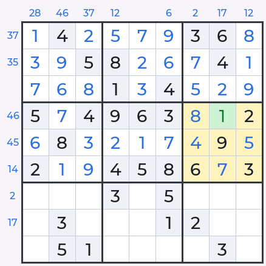

<!-- Written by tools/walkthrough.py next-to-nine: edit the script, not this page. -->
# Next to Nine, step 32: the 1 in box 6

**Step 32 of 51** · [← Step 31](step-31.md) · [All steps](../next-to-nine.md#the-whole-puzzle-step-by-step) · [Step 33 →](step-33.md)

Box 6 needs a 1, and r4c8 is its last empty cell: **r4c8 = 1**.

**Step 32 of 51** · [← Step 31](step-31.md) · [All steps](../next-to-nine.md#the-whole-puzzle-step-by-step) · [Step 33 →](step-33.md)
