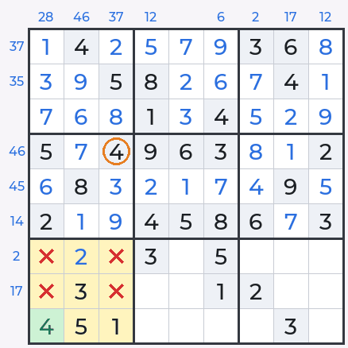

<!-- Written by tools/walkthrough.py next-to-nine: edit the script, not this page. -->
# Next to Nine, step 34: the 4 in box 7

**Step 34 of 51** · [← Step 33](step-33.md) · [All steps](../next-to-nine.md#the-whole-puzzle-step-by-step) · [Step 35 →](step-35.md)

Box 7 needs a 4. r7c3 and r8c3: column 3 has one (r4c3). r7c1: with a 4 there, row 7 couldn't have 2 beside its 9. r8c1: with a 4 there, column 1 couldn't have 2 and 8 beside its 9. Only **r9c1** is left: **r9c1 = 4**.

**Step 34 of 51** · [← Step 33](step-33.md) · [All steps](../next-to-nine.md#the-whole-puzzle-step-by-step) · [Step 35 →](step-35.md)
