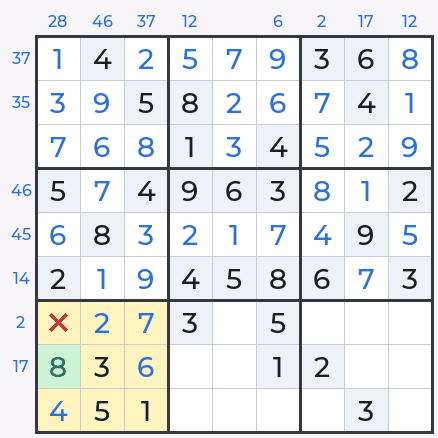

<!-- Written by tools/walkthrough.py next-to-nine: edit the script, not this page. -->
# Next to Nine, step 37: the 8 in box 7

**Step 37 of 51** · [← Step 36](step-36.md) · [All steps](../next-to-nine.md#the-whole-puzzle-step-by-step) · [Step 38 →](step-38.md)

Box 7 needs an 8. r7c1: with an 8 there, row 7 couldn't have 2 beside its 9. Only **r8c1** is left: **r8c1 = 8**.

**Step 37 of 51** · [← Step 36](step-36.md) · [All steps](../next-to-nine.md#the-whole-puzzle-step-by-step) · [Step 38 →](step-38.md)
