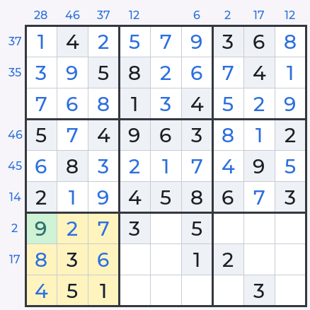

<!-- Written by tools/walkthrough.py next-to-nine: edit the script, not this page. -->
# Next to Nine, step 38: the 9 in box 7

**Step 38 of 51** · [← Step 37](step-37.md) · [All steps](../next-to-nine.md#the-whole-puzzle-step-by-step) · [Step 39 →](step-39.md)

Box 7 needs a 9, and r7c1 is its last empty cell: **r7c1 = 9**.

**Step 38 of 51** · [← Step 37](step-37.md) · [All steps](../next-to-nine.md#the-whole-puzzle-step-by-step) · [Step 39 →](step-39.md)
