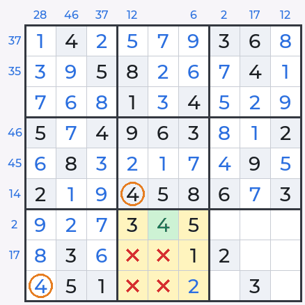

<!-- Written by tools/walkthrough.py next-to-nine: edit the script, not this page. -->
# Next to Nine, step 40: the 4 in box 8

**Step 40 of 51** · [← Step 39](step-39.md) · [All steps](../next-to-nine.md#the-whole-puzzle-step-by-step) · [Step 41 →](step-41.md)

Box 8 needs a 4. r8c4: column 4 has one (r6c4). r9c4 and r9c5: row 9 has one (r9c1). r8c5: with a 4 there, row 8 couldn't have 1 and 7 beside its 9. Only **r7c5** is left: **r7c5 = 4**.

**Step 40 of 51** · [← Step 39](step-39.md) · [All steps](../next-to-nine.md#the-whole-puzzle-step-by-step) · [Step 41 →](step-41.md)
