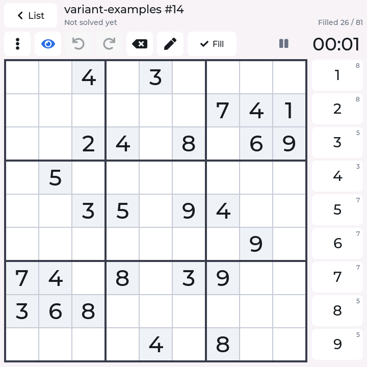

# Non-Consecutive

[← All variants](README.md) · [Puzzles](../features-puzzles.md) · [How to play](../how-to-play.md)

## The rules

[Classic](classic.md) rules, and two **side-by-side** cells (left and right, or above and below) never hold digits that are **1 apart**: no 4 next to a 3 or a 5. Cells that touch only at a corner don't count.

It's [Consecutive](consecutive.md) with no bars at all.

## On the board

- Nothing extra is drawn.
- Two neighbours 1 apart turn red.
- The grader and hints treat it like Consecutive without bars: "Its neighbours can't be 1 apart from row 4, column 2, which leaves it only 3, 7".
- **Puzzles → ⋮ → New puzzle → Non-Consecutive**. Easy keeps 24 or more givens. It's the slowest variant to make (a few seconds at Hard).

## How to solve it

- **Every filled cell rules out two digits in up to four neighbours:** next to a 6, no 5 or 7. Next to a 1 or a 9, only one (no 2, no 8).
- When the Classic rules leave a cell two or three candidates, look at its four neighbours: one of them often rules a candidate out, as in every step of the worked example.
- **Between two digits:** a cell between a 4 and a 6 can't be 3, 5 or 7.
- Digits alternate a lot: neighbours are never "close", so a row tends to swing between low and high digits.

## Worked example

**variant-examples #14**, Non-Consecutive Easy (see [Classic](classic.md#worked-example-the-whole-puzzle) for how to import the examples; cells are written r*row*c*column*).

**Step 1: r7c3.** Row 7 has 7, 4, 8, 3 and 9; column 3 has 4, 2, 3 and 8; box 7 has 7, 4, 3, 6 and 8. By the Classic rules r7c3 could be 1 or 5. Its left neighbour, r7c2, is a 4, and 5 is 1 away from 4. **r7c3 = 1**.

**Step 2: r9c3.** Row 9 has 4 and 8; column 3 now has 4, 2, 3, 8 and the new 1; box 7 has 7, 4, 1, 3, 6 and 8. That leaves 5 and 9. The cell above, r8c3, is an 8, and 9 is 1 away from 8. **r9c3 = 5**.

**Step 3: r9c1.** Row 9 has 4, 8 and now 5; column 1 has 7 and 3; box 7 has 7, 4, 1, 3, 6, 8 and 5. That leaves 2 and 9. The cell above, r8c1, is a 3, and 2 is 1 away from 3. **r9c1 = 9**.

Box 7 now has one empty cell, r9c2, and one missing digit, 2. Check it against the rule: its neighbours are 9, 5 and (above) 6, none of them 1 or 3. **r9c2 = 2**.

## The whole puzzle, step by step

<!-- walkthrough -->
<!-- Written by tools/walkthrough.py non-consecutive: edit the script, not this part. -->

The whole puzzle, from the start to the last cell: 55 steps, each one a single (one place left for a digit, or one digit left for a cell), taken in the order a box's single comes first, so not quite the order of the worked example above. Each step has a page of its own, with **Previous** and **Next**: pick its number below. In each picture, the unit the step looks at is tinted yellow (for a cell with one digit left: its row, column and box), the new digit is on green, the digits that rule cells out have an **orange ring**, and the empty cells they rule out a **red cross**. Givens are on grey, digits from earlier steps in blue.

| [1](non-consecutive/step-01.md) | [2](non-consecutive/step-02.md) | [3](non-consecutive/step-03.md) | [4](non-consecutive/step-04.md) | [5](non-consecutive/step-05.md) | [6](non-consecutive/step-06.md) | [7](non-consecutive/step-07.md) | [8](non-consecutive/step-08.md) | [9](non-consecutive/step-09.md) | [10](non-consecutive/step-10.md) |
|:-:|:-:|:-:|:-:|:-:|:-:|:-:|:-:|:-:|:-:|
| [11](non-consecutive/step-11.md) | [12](non-consecutive/step-12.md) | [13](non-consecutive/step-13.md) | [14](non-consecutive/step-14.md) | [15](non-consecutive/step-15.md) | [16](non-consecutive/step-16.md) | [17](non-consecutive/step-17.md) | [18](non-consecutive/step-18.md) | [19](non-consecutive/step-19.md) | [20](non-consecutive/step-20.md) |
| [21](non-consecutive/step-21.md) | [22](non-consecutive/step-22.md) | [23](non-consecutive/step-23.md) | [24](non-consecutive/step-24.md) | [25](non-consecutive/step-25.md) | [26](non-consecutive/step-26.md) | [27](non-consecutive/step-27.md) | [28](non-consecutive/step-28.md) | [29](non-consecutive/step-29.md) | [30](non-consecutive/step-30.md) |
| [31](non-consecutive/step-31.md) | [32](non-consecutive/step-32.md) | [33](non-consecutive/step-33.md) | [34](non-consecutive/step-34.md) | [35](non-consecutive/step-35.md) | [36](non-consecutive/step-36.md) | [37](non-consecutive/step-37.md) | [38](non-consecutive/step-38.md) | [39](non-consecutive/step-39.md) | [40](non-consecutive/step-40.md) |
| [41](non-consecutive/step-41.md) | [42](non-consecutive/step-42.md) | [43](non-consecutive/step-43.md) | [44](non-consecutive/step-44.md) | [45](non-consecutive/step-45.md) | [46](non-consecutive/step-46.md) | [47](non-consecutive/step-47.md) | [48](non-consecutive/step-48.md) | [49](non-consecutive/step-49.md) | [50](non-consecutive/step-50.md) |
| [51](non-consecutive/step-51.md) | [52](non-consecutive/step-52.md) | [53](non-consecutive/step-53.md) | [54](non-consecutive/step-54.md) | [55](non-consecutive/step-55.md) |  |  |  |  |  |

Solved.

<!-- /walkthrough -->
