# Non-Consecutive

[← All variants](README.md) · [Puzzles](../features-puzzles.md) · [How to play](../how-to-play.md)


## The rules

[Classic](classic.md) rules, and two **side-by-side** cells (left and right, or above and below) never hold digits that are **1 apart**: no 4 next to a 3 or a 5. Cells that touch only at a corner don't count.

It's [Consecutive](consecutive.md) with no bars at all.

## On the board

- Nothing extra is drawn.
- Two neighbours 1 apart turn red.
- The grader and hints treat it like Consecutive without bars: "Its neighbours can't be 1 apart from row 4, column 2, which leaves it only 3, 7".
- **Puzzles → ⋮ → New puzzle → Non-Consecutive**. Easy keeps 24 or more givens. It's the slowest variant to make (a few seconds at Hard).

## How to solve it

- **Every filled cell rules out two digits in up to four neighbours:** next to a 6, no 5 or 7. Next to a 1 or a 9, only one (no 2, no 8).
- When the Classic rules leave a cell two or three candidates, look at its four neighbours: one of them often rules a candidate out, as in every step of the worked example.
- **Between two digits:** a cell between a 4 and a 6 can't be 3, 5 or 7.
- Digits alternate a lot: neighbours are never "close", so a row tends to swing between low and high digits.

## Worked example

**variant-examples #14**, Non-Consecutive Easy (see [Classic](classic.md#worked-example) for how to import the examples; cells are written r*row*c*column*).

```
. . 4 | . 3 . | . . .
. . . | . . . | 7 4 1
. . 2 | 4 . 8 | . 6 9
------+-------+------
. 5 . | . . . | . . .
. . 3 | 5 . 9 | 4 . .
. . . | . . . | . 9 .
------+-------+------
7 4 . | 8 . 3 | 9 . .
3 6 8 | . . . | . . .
. . . | . 4 . | 8 . .
```

**Step 1: r7c3.** Row 7 has 7, 4, 8, 3 and 9; column 3 has 4, 2, 3 and 8; box 7 has 7, 4, 3, 6 and 8. By the Classic rules r7c3 could be 1 or 5. Its left neighbour, r7c2, is a 4, and 5 is 1 away from 4. **r7c3 = 1**.

**Step 2: r9c3.** Row 9 has 4 and 8; column 3 now has 4, 2, 3, 8 and the new 1; box 7 has 7, 4, 1, 3, 6 and 8. That leaves 5 and 9. The cell above, r8c3, is an 8, and 9 is 1 away from 8. **r9c3 = 5**.

**Step 3: r9c1.** Row 9 has 4, 8 and now 5; column 1 has 7 and 3; box 7 has 7, 4, 1, 3, 6, 8 and 5. That leaves 2 and 9. The cell above, r8c1, is a 3, and 2 is 1 away from 3. **r9c1 = 9**.

Box 7 now has one empty cell, r9c2, and one missing digit, 2. Check it against the rule: its neighbours are 9, 5 and (above) 6, none of them 1 or 3. **r9c2 = 2**.

## The whole puzzle, step by step

<!-- walkthrough -->
<!-- Written by tools/walkthrough.py non-consecutive: edit the script, not this part. -->

The whole puzzle, from the start to the last cell: 55 steps, each one a single (one place left for a digit, or one digit left for a cell), taken in the order a box's single comes first, so not quite the order of the worked example above. In each picture, the unit the step looks at is tinted yellow (for a cell with one digit left: its row, column and box), the new digit is on green, the digits that rule cells out have an **orange ring**, and the empty cells they rule out a **red cross**. Givens are on grey, digits from earlier steps in blue.

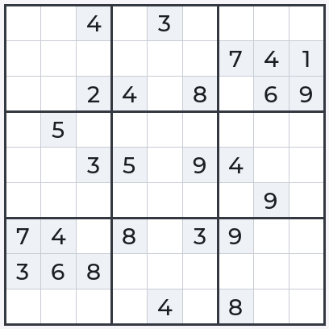

#### Step 1: the 3 in box 1

Box 1 needs a 3. r1c1 and r1c2: row 1 has one (r1c5). r2c1 and r3c1: column 1 has one (r8c1). r2c3: column 3 has one (r5c3). r3c2: it has no bar to the 2 in r3c3, so it isn't 1 or 3. Only **r2c2** is left: **r2c2 = 3**.


#### Step 2: the 3 in box 3

Box 3 needs a 3. r1c7, r1c8 and r1c9: row 1 has one (r1c5). Only **r3c7** is left: **r3c7 = 3**.


#### Step 3: the 4 in box 4

Box 4 needs a 4. r4c3 and r6c3: column 3 has one (r1c3). r5c1 and r5c2: row 5 has one (r5c7). r6c2: column 2 has one (r7c2). r4c1: it has no bar to the 5 in r4c2, so it isn't 4 or 6. Only **r6c1** is left: **r6c1 = 4**.


#### Step 4: the 3 in box 5

Box 5 needs a 3. r4c5 and r6c5: column 5 has one (r1c5). r4c6 and r6c6: column 6 has one (r7c6). r5c5: row 5 has one (r5c3). r4c4: it has no bar to the 4 in r3c4, so it isn't 3 or 5. Only **r6c4** is left: **r6c4 = 3**.

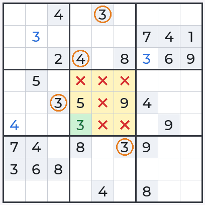

#### Step 5: the 4 in box 5

Box 5 needs a 4. r4c4: column 4 has one (r3c4). r4c5: column 5 has one (r9c5). r5c5: row 5 has one (r5c7). r6c5 and r6c6: row 6 has one (r6c1). Only **r4c6** is left: **r4c6 = 4**.


#### Step 6: the 5 in box 6

Box 6 needs a 5. r4c7, r4c8 and r4c9: row 4 has one (r4c2). r5c8 and r5c9: row 5 has one (r5c4). r6c7: it has no bar to the 4 in r5c7, so it isn't 3 or 5. Only **r6c9** is left: **r6c9 = 5**.


#### Step 7: the 5 in box 3

Box 3 needs a 5. r1c9: column 9 has one (r6c9). r1c8: it has no bar to the 4 in r2c8, so it isn't 3 or 5. Only **r1c7** is left: **r1c7 = 5**.

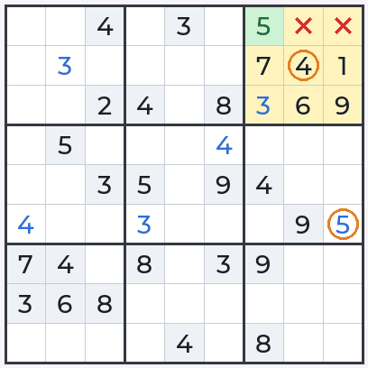

#### Step 8: the 2 in box 3

Box 3 needs a 2. r1c9: it has no bar to the 1 in r2c9, so it isn't 2. Only **r1c8** is left: **r1c8 = 2**.

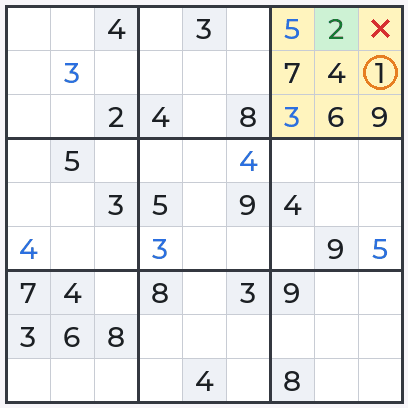

#### Step 9: the 8 in box 3

Box 3 needs an 8, and r1c9 is its last empty cell: **r1c9 = 8**.


#### Step 10: the 8 in box 1

Box 1 needs an 8. r1c1 and r1c2: row 1 has one (r1c9). r2c3: column 3 has one (r8c3). r3c1 and r3c2: row 3 has one (r3c6). Only **r2c1** is left: **r2c1 = 8**.


#### Step 11: the 5 in box 1

Box 1 needs a 5. r1c1 and r1c2: row 1 has one (r1c7). r3c2: column 2 has one (r4c2). r2c3: it has no bar to the 4 in r1c3, so it isn't 3 or 5. Only **r3c1** is left: **r3c1 = 5**.

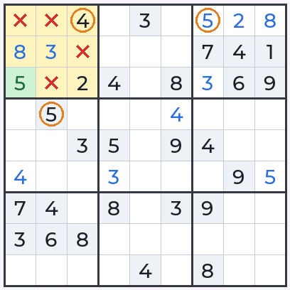

#### Step 12: the 8 in box 6

Box 6 needs an 8. r4c7 and r6c7: column 7 has one (r9c7). r4c9 and r5c9: column 9 has one (r1c9). r5c8: it has no bar to the 9 in r6c8, so it isn't 8. Only **r4c8** is left: **r4c8 = 8**.


#### Step 13: the 8 in box 5

Box 5 needs an 8. r4c4 and r4c5: row 4 has one (r4c8). r6c6: column 6 has one (r3c6). r5c5: it has no bar to the 9 in r5c6, so it isn't 8. Only **r6c5** is left: **r6c5 = 8**.


#### Step 14: the 8 in box 4

Box 4 needs an 8. r4c1 and r4c3: row 4 has one (r4c8). r5c1: column 1 has one (r2c1). r6c2 and r6c3: row 6 has one (r6c5). Only **r5c2** is left: **r5c2 = 8**.


#### Step 15: the 3 in box 6

Box 6 needs a 3. r4c7: column 7 has one (r3c7). r5c8 and r5c9: row 5 has one (r5c3). r6c7: row 6 has one (r6c4). Only **r4c9** is left: **r4c9 = 3**.


#### Step 16: the 2 in box 6

Box 6 needs a 2. r5c8: column 8 has one (r1c8). r4c7: it has no bar to the 3 in r3c7, so it isn't 2 or 4. r5c9: it has no bar to the 3 in r4c9, so it isn't 2 or 4. Only **r6c7** is left: **r6c7 = 2**.


#### Step 17: the 6 in box 6

Box 6 needs a 6. r5c8: column 8 has one (r3c8). r5c9: it has no bar to the 5 in r6c9, so it isn't 4 or 6. Only **r4c7** is left: **r4c7 = 6**.

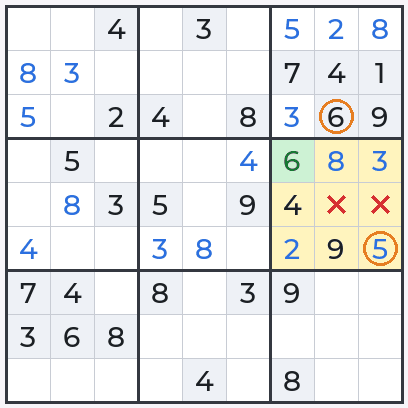

#### Step 18: the 6 in box 5

Box 5 needs a 6. r4c4 and r4c5: row 4 has one (r4c7). r5c5: it has no bar to the 5 in r5c4, so it isn't 4 or 6. Only **r6c6** is left: **r6c6 = 6**.


#### Step 19: the 6 in box 4

Box 4 needs a 6. r4c1 and r4c3: row 4 has one (r4c7). r6c2 and r6c3: row 6 has one (r6c6). Only **r5c1** is left: **r5c1 = 6**.


#### Step 20: the 6 in box 1

Box 1 needs a 6. r1c1: column 1 has one (r5c1). r1c2: column 2 has one (r8c2). r3c2: row 3 has one (r3c8). Only **r2c3** is left: **r2c3 = 6**.


#### Step 21: the 9 in box 1

Box 1 needs a 9. r3c2: row 3 has one (r3c9). r1c1: it has no bar to the 8 in r2c1, so it isn't 7 or 9. Only **r1c2** is left: **r1c2 = 9**.

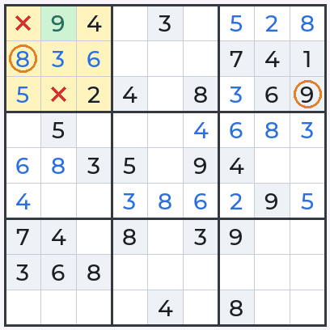

#### Step 22: the 1 in box 1

Box 1 needs a 1. r3c2: it has no bar to the 2 in r3c3, so it isn't 1 or 3. Only **r1c1** is left: **r1c1 = 1**.


#### Step 23: the 7 in box 1

Box 1 needs a 7, and r3c2 is its last empty cell: **r3c2 = 7**.

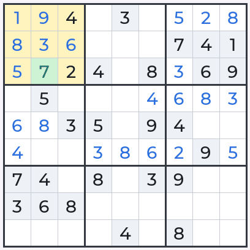

#### Step 24: the 1 in box 2

Box 2 needs a 1. r1c4 and r1c6: row 1 has one (r1c1). r2c4, r2c5 and r2c6: row 2 has one (r2c9). Only **r3c5** is left: **r3c5 = 1**.

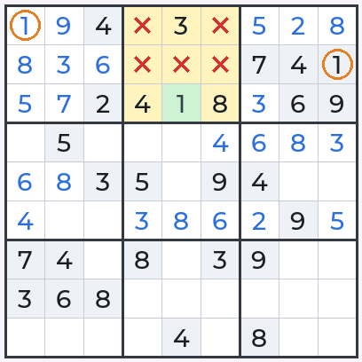

#### Step 25: the 6 in box 2

Box 2 needs a 6. r1c6: column 6 has one (r6c6). r2c4, r2c5 and r2c6: row 2 has one (r2c3). Only **r1c4** is left: **r1c4 = 6**.


#### Step 26: the 7 in box 2

Box 2 needs a 7. r2c4, r2c5 and r2c6: row 2 has one (r2c7). Only **r1c6** is left: **r1c6 = 7**.

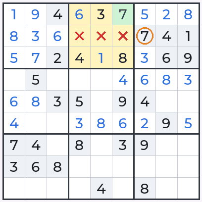

#### Step 27: the 2 in box 4

Box 4 needs a 2. r4c3: column 3 has one (r3c3). r6c2 and r6c3: row 6 has one (r6c7). Only **r4c1** is left: **r4c1 = 2**.

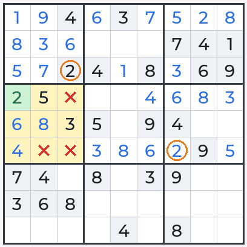

#### Step 28: the 9 in box 4

Box 4 needs a 9. r6c2 and r6c3: row 6 has one (r6c8). Only **r4c3** is left: **r4c3 = 9**.

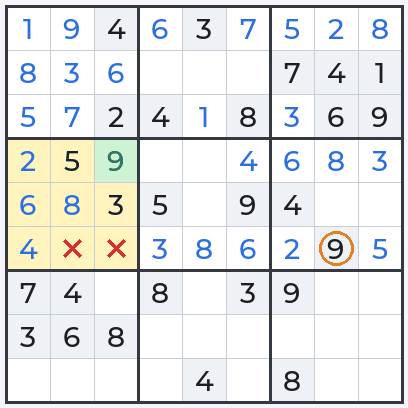

#### Step 29: the 7 in box 4

Box 4 needs a 7. r6c2: column 2 has one (r3c2). Only **r6c3** is left: **r6c3 = 7**.


#### Step 30: the 1 in box 4

Box 4 needs a 1, and r6c2 is its last empty cell: **r6c2 = 1**.

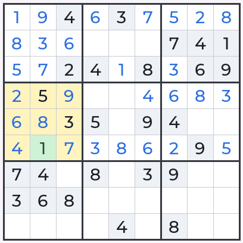

#### Step 31: the 1 in box 5

Box 5 needs a 1. r4c5 and r5c5: column 5 has one (r3c5). Only **r4c4** is left: **r4c4 = 1**.


#### Step 32: the 2 in box 5

Box 5 needs a 2. r4c5: row 4 has one (r4c1). Only **r5c5** is left: **r5c5 = 2**.

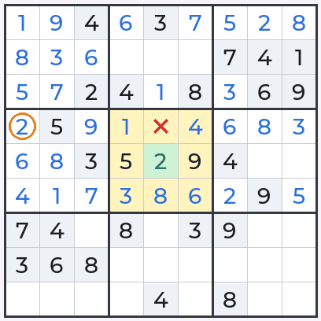

#### Step 33: the 7 in box 5

Box 5 needs a 7, and r4c5 is its last empty cell: **r4c5 = 7**.

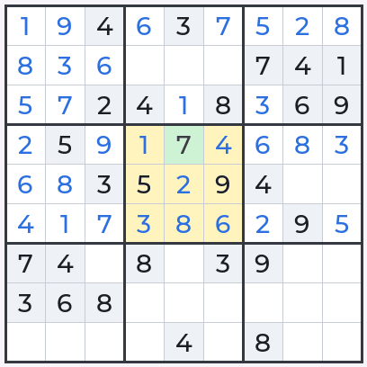

#### Step 34: the 1 in box 6

Box 6 needs a 1. r5c9: column 9 has one (r2c9). Only **r5c8** is left: **r5c8 = 1**.


#### Step 35: the 7 in box 6

Box 6 needs a 7, and r5c9 is its last empty cell: **r5c9 = 7**.


#### Step 36: the 2 in box 7

Box 7 needs a 2. r7c3 and r9c3: column 3 has one (r3c3). r9c1: column 1 has one (r4c1). Only **r9c2** is left: **r9c2 = 2**.

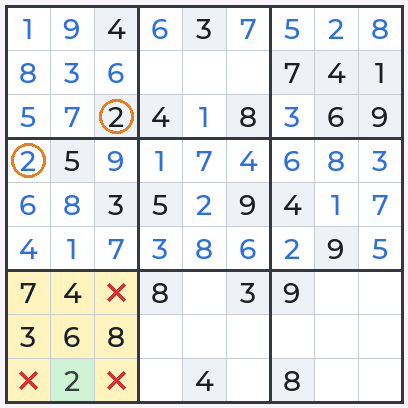

#### Step 37: the 1 in box 7

Box 7 needs a 1. r9c1: column 1 has one (r1c1). r9c3: it has no bar to the 2 in r9c2, so it isn't 1 or 3. Only **r7c3** is left: **r7c3 = 1**.


#### Step 38: the 5 in box 7

Box 7 needs a 5. r9c1: column 1 has one (r3c1). Only **r9c3** is left: **r9c3 = 5**.


#### Step 39: the 9 in box 7

Box 7 needs a 9, and r9c1 is its last empty cell: **r9c1 = 9**.


#### Step 40: the 2 in box 8

Box 8 needs a 2. r7c5 and r8c5: column 5 has one (r5c5). r9c4 and r9c6: row 9 has one (r9c2). r8c6: it has no bar to the 3 in r7c6, so it isn't 2 or 4. Only **r8c4** is left: **r8c4 = 2**.

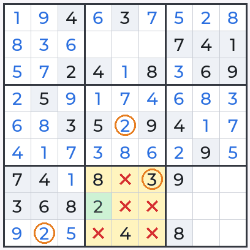

#### Step 41: the 2 in box 2

Box 2 needs a 2. r2c4: column 4 has one (r8c4). r2c5: column 5 has one (r5c5). Only **r2c6** is left: **r2c6 = 2**.


#### Step 42: the 5 in box 2

Box 2 needs a 5. r2c4: column 4 has one (r5c4). Only **r2c5** is left: **r2c5 = 5**.

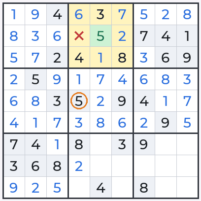

#### Step 43: the 9 in box 2

Box 2 needs a 9, and r2c4 is its last empty cell: **r2c4 = 9**.

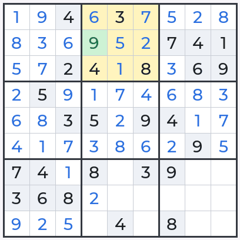

#### Step 44: the 5 in box 8

Box 8 needs a 5. r7c5 and r8c5: column 5 has one (r2c5). r9c4 and r9c6: row 9 has one (r9c3). Only **r8c6** is left: **r8c6 = 5**.


#### Step 45: the 1 in box 8

Box 8 needs a 1. r7c5: row 7 has one (r7c3). r8c5: column 5 has one (r3c5). r9c4: column 4 has one (r4c4). Only **r9c6** is left: **r9c6 = 1**.


#### Step 46: the 6 in box 8

Box 8 needs a 6. r8c5: row 8 has one (r8c2). r9c4: column 4 has one (r1c4). Only **r7c5** is left: **r7c5 = 6**.


#### Step 47: the 7 in box 8

Box 8 needs a 7. r8c5: column 5 has one (r4c5). Only **r9c4** is left: **r9c4 = 7**.

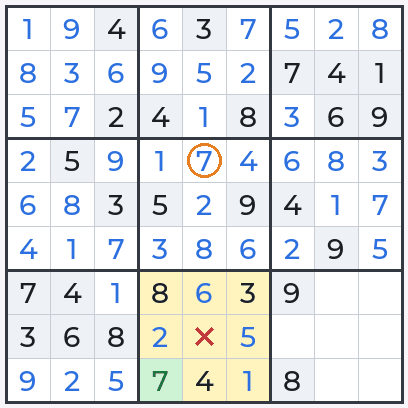

#### Step 48: the 9 in box 8

Box 8 needs a 9, and r8c5 is its last empty cell: **r8c5 = 9**.

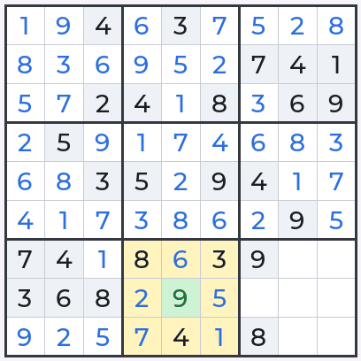

#### Step 49: the 1 in box 9

Box 9 needs a 1. r7c8 and r7c9: row 7 has one (r7c3). r8c8: column 8 has one (r5c8). r8c9: column 9 has one (r2c9). r9c8 and r9c9: row 9 has one (r9c6). Only **r8c7** is left: **r8c7 = 1**.


#### Step 50: the 2 in box 9

Box 9 needs a 2. r7c8: column 8 has one (r1c8). r8c8 and r8c9: row 8 has one (r8c4). r9c8 and r9c9: row 9 has one (r9c2). Only **r7c9** is left: **r7c9 = 2**.


#### Step 51: the 3 in box 9

Box 9 needs a 3. r7c8: row 7 has one (r7c6). r8c8 and r8c9: row 8 has one (r8c1). r9c9: column 9 has one (r4c9). Only **r9c8** is left: **r9c8 = 3**.

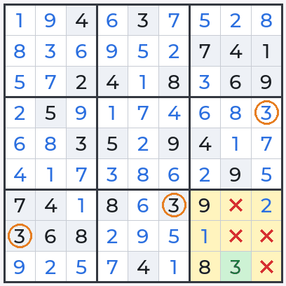

#### Step 52: the 4 in box 9

Box 9 needs a 4. r7c8: row 7 has one (r7c2). r8c8: column 8 has one (r2c8). r9c9: row 9 has one (r9c5). Only **r8c9** is left: **r8c9 = 4**.

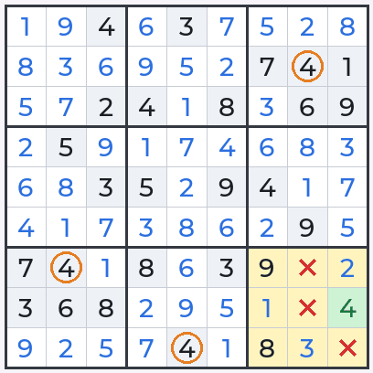

#### Step 53: the 5 in box 9

Box 9 needs a 5. r8c8: row 8 has one (r8c6). r9c9: row 9 has one (r9c3). Only **r7c8** is left: **r7c8 = 5**.


#### Step 54: the 6 in box 9

Box 9 needs a 6. r8c8: row 8 has one (r8c2). Only **r9c9** is left: **r9c9 = 6**.

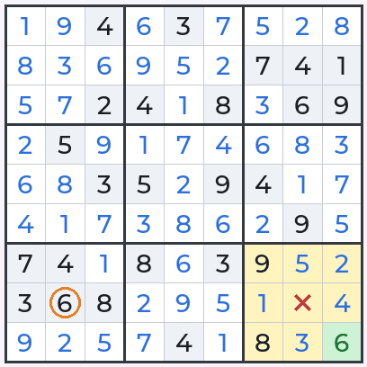

#### Step 55: the 7 in box 9

Box 9 needs a 7, and r8c8 is its last empty cell: **r8c8 = 7**.


Solved.

<!-- /walkthrough -->
