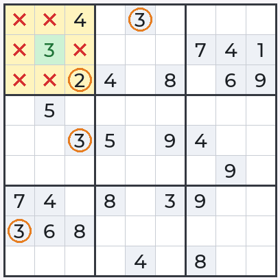

<!-- Written by tools/walkthrough.py non-consecutive: edit the script, not this page. -->
# Non-Consecutive, step 1: the 3 in box 1

**Step 1 of 55** · [← The start](../non-consecutive.md#the-whole-puzzle-step-by-step) · [All steps](../non-consecutive.md#the-whole-puzzle-step-by-step) · [Step 2 →](step-02.md)

Box 1 needs a 3. r1c1 and r1c2: row 1 has one (r1c5). r2c1 and r3c1: column 1 has one (r8c1). r2c3: column 3 has one (r5c3). r3c2: it has no bar to the 2 in r3c3, so it isn't 1 or 3. Only **r2c2** is left: **r2c2 = 3**.

**Step 1 of 55** · [← The start](../non-consecutive.md#the-whole-puzzle-step-by-step) · [All steps](../non-consecutive.md#the-whole-puzzle-step-by-step) · [Step 2 →](step-02.md)
