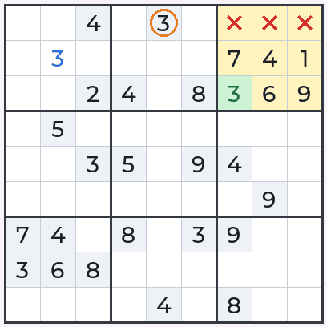

<!-- Written by tools/walkthrough.py non-consecutive: edit the script, not this page. -->
# Non-Consecutive, step 2: the 3 in box 3

**Step 2 of 55** · [← Step 1](step-01.md) · [All steps](../non-consecutive.md#the-whole-puzzle-step-by-step) · [Step 3 →](step-03.md)

Box 3 needs a 3. r1c7, r1c8 and r1c9: row 1 has one (r1c5). Only **r3c7** is left: **r3c7 = 3**.

**Step 2 of 55** · [← Step 1](step-01.md) · [All steps](../non-consecutive.md#the-whole-puzzle-step-by-step) · [Step 3 →](step-03.md)
