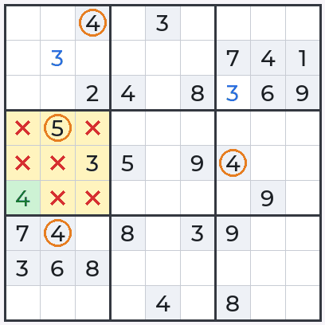

<!-- Written by tools/walkthrough.py non-consecutive: edit the script, not this page. -->
# Non-Consecutive, step 3: the 4 in box 4

**Step 3 of 55** · [← Step 2](step-02.md) · [All steps](../non-consecutive.md#the-whole-puzzle-step-by-step) · [Step 4 →](step-04.md)

Box 4 needs a 4. r4c3 and r6c3: column 3 has one (r1c3). r5c1 and r5c2: row 5 has one (r5c7). r6c2: column 2 has one (r7c2). r4c1: it has no bar to the 5 in r4c2, so it isn't 4 or 6. Only **r6c1** is left: **r6c1 = 4**.

**Step 3 of 55** · [← Step 2](step-02.md) · [All steps](../non-consecutive.md#the-whole-puzzle-step-by-step) · [Step 4 →](step-04.md)
