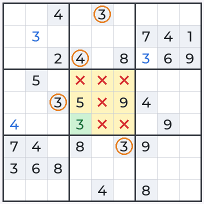

<!-- Written by tools/walkthrough.py non-consecutive: edit the script, not this page. -->
# Non-Consecutive, step 4: the 3 in box 5

**Step 4 of 55** · [← Step 3](step-03.md) · [All steps](../non-consecutive.md#the-whole-puzzle-step-by-step) · [Step 5 →](step-05.md)

Box 5 needs a 3. r4c5 and r6c5: column 5 has one (r1c5). r4c6 and r6c6: column 6 has one (r7c6). r5c5: row 5 has one (r5c3). r4c4: it has no bar to the 4 in r3c4, so it isn't 3 or 5. Only **r6c4** is left: **r6c4 = 3**.

**Step 4 of 55** · [← Step 3](step-03.md) · [All steps](../non-consecutive.md#the-whole-puzzle-step-by-step) · [Step 5 →](step-05.md)
