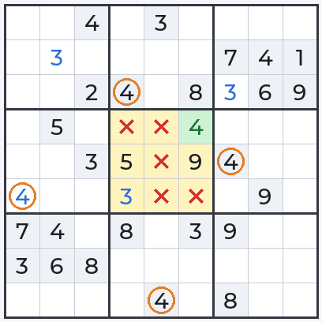

<!-- Written by tools/walkthrough.py non-consecutive: edit the script, not this page. -->
# Non-Consecutive, step 5: the 4 in box 5

**Step 5 of 55** · [← Step 4](step-04.md) · [All steps](../non-consecutive.md#the-whole-puzzle-step-by-step) · [Step 6 →](step-06.md)

Box 5 needs a 4. r4c4: column 4 has one (r3c4). r4c5: column 5 has one (r9c5). r5c5: row 5 has one (r5c7). r6c5 and r6c6: row 6 has one (r6c1). Only **r4c6** is left: **r4c6 = 4**.

**Step 5 of 55** · [← Step 4](step-04.md) · [All steps](../non-consecutive.md#the-whole-puzzle-step-by-step) · [Step 6 →](step-06.md)
