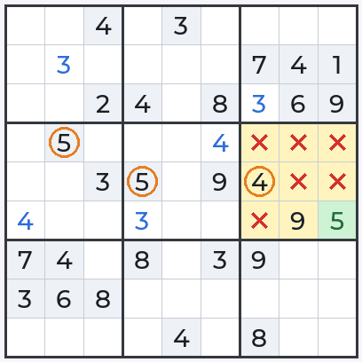

<!-- Written by tools/walkthrough.py non-consecutive: edit the script, not this page. -->
# Non-Consecutive, step 6: the 5 in box 6

**Step 6 of 55** · [← Step 5](step-05.md) · [All steps](../non-consecutive.md#the-whole-puzzle-step-by-step) · [Step 7 →](step-07.md)

Box 6 needs a 5. r4c7, r4c8 and r4c9: row 4 has one (r4c2). r5c8 and r5c9: row 5 has one (r5c4). r6c7: it has no bar to the 4 in r5c7, so it isn't 3 or 5. Only **r6c9** is left: **r6c9 = 5**.

**Step 6 of 55** · [← Step 5](step-05.md) · [All steps](../non-consecutive.md#the-whole-puzzle-step-by-step) · [Step 7 →](step-07.md)
