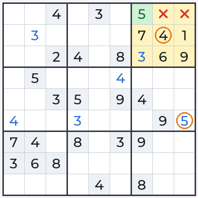

<!-- Written by tools/walkthrough.py non-consecutive: edit the script, not this page. -->
# Non-Consecutive, step 7: the 5 in box 3

**Step 7 of 55** · [← Step 6](step-06.md) · [All steps](../non-consecutive.md#the-whole-puzzle-step-by-step) · [Step 8 →](step-08.md)

Box 3 needs a 5. r1c9: column 9 has one (r6c9). r1c8: it has no bar to the 4 in r2c8, so it isn't 3 or 5. Only **r1c7** is left: **r1c7 = 5**.

**Step 7 of 55** · [← Step 6](step-06.md) · [All steps](../non-consecutive.md#the-whole-puzzle-step-by-step) · [Step 8 →](step-08.md)
