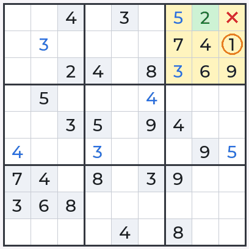

<!-- Written by tools/walkthrough.py non-consecutive: edit the script, not this page. -->
# Non-Consecutive, step 8: the 2 in box 3

**Step 8 of 55** · [← Step 7](step-07.md) · [All steps](../non-consecutive.md#the-whole-puzzle-step-by-step) · [Step 9 →](step-09.md)

Box 3 needs a 2. r1c9: it has no bar to the 1 in r2c9, so it isn't 2. Only **r1c8** is left: **r1c8 = 2**.

**Step 8 of 55** · [← Step 7](step-07.md) · [All steps](../non-consecutive.md#the-whole-puzzle-step-by-step) · [Step 9 →](step-09.md)
