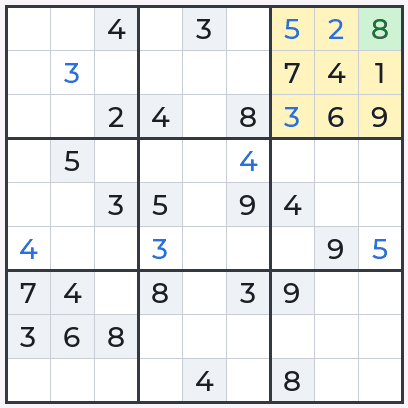

<!-- Written by tools/walkthrough.py non-consecutive: edit the script, not this page. -->
# Non-Consecutive, step 9: the 8 in box 3

**Step 9 of 55** · [← Step 8](step-08.md) · [All steps](../non-consecutive.md#the-whole-puzzle-step-by-step) · [Step 10 →](step-10.md)

Box 3 needs an 8, and r1c9 is its last empty cell: **r1c9 = 8**.

**Step 9 of 55** · [← Step 8](step-08.md) · [All steps](../non-consecutive.md#the-whole-puzzle-step-by-step) · [Step 10 →](step-10.md)
