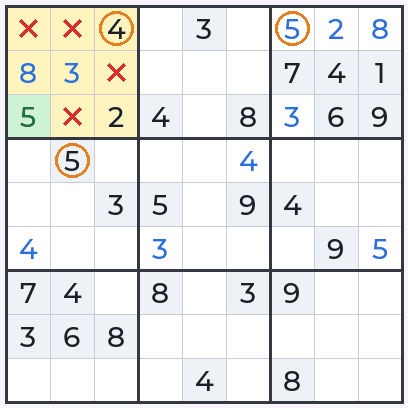

<!-- Written by tools/walkthrough.py non-consecutive: edit the script, not this page. -->
# Non-Consecutive, step 11: the 5 in box 1

**Step 11 of 55** · [← Step 10](step-10.md) · [All steps](../non-consecutive.md#the-whole-puzzle-step-by-step) · [Step 12 →](step-12.md)

Box 1 needs a 5. r1c1 and r1c2: row 1 has one (r1c7). r3c2: column 2 has one (r4c2). r2c3: it has no bar to the 4 in r1c3, so it isn't 3 or 5. Only **r3c1** is left: **r3c1 = 5**.

**Step 11 of 55** · [← Step 10](step-10.md) · [All steps](../non-consecutive.md#the-whole-puzzle-step-by-step) · [Step 12 →](step-12.md)
