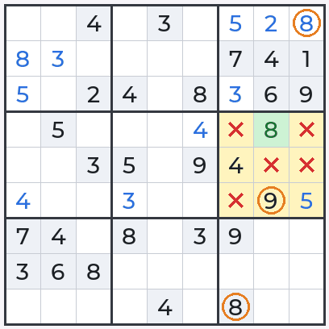

<!-- Written by tools/walkthrough.py non-consecutive: edit the script, not this page. -->
# Non-Consecutive, step 12: the 8 in box 6

**Step 12 of 55** · [← Step 11](step-11.md) · [All steps](../non-consecutive.md#the-whole-puzzle-step-by-step) · [Step 13 →](step-13.md)

Box 6 needs an 8. r4c7 and r6c7: column 7 has one (r9c7). r4c9 and r5c9: column 9 has one (r1c9). r5c8: it has no bar to the 9 in r6c8, so it isn't 8. Only **r4c8** is left: **r4c8 = 8**.

**Step 12 of 55** · [← Step 11](step-11.md) · [All steps](../non-consecutive.md#the-whole-puzzle-step-by-step) · [Step 13 →](step-13.md)
