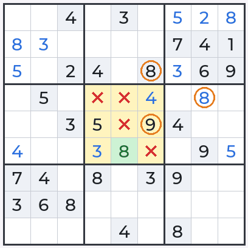

<!-- Written by tools/walkthrough.py non-consecutive: edit the script, not this page. -->
# Non-Consecutive, step 13: the 8 in box 5

**Step 13 of 55** · [← Step 12](step-12.md) · [All steps](../non-consecutive.md#the-whole-puzzle-step-by-step) · [Step 14 →](step-14.md)

Box 5 needs an 8. r4c4 and r4c5: row 4 has one (r4c8). r6c6: column 6 has one (r3c6). r5c5: it has no bar to the 9 in r5c6, so it isn't 8. Only **r6c5** is left: **r6c5 = 8**.

**Step 13 of 55** · [← Step 12](step-12.md) · [All steps](../non-consecutive.md#the-whole-puzzle-step-by-step) · [Step 14 →](step-14.md)
