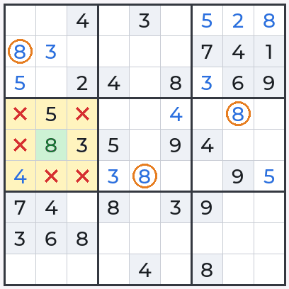

<!-- Written by tools/walkthrough.py non-consecutive: edit the script, not this page. -->
# Non-Consecutive, step 14: the 8 in box 4

**Step 14 of 55** · [← Step 13](step-13.md) · [All steps](../non-consecutive.md#the-whole-puzzle-step-by-step) · [Step 15 →](step-15.md)

Box 4 needs an 8. r4c1 and r4c3: row 4 has one (r4c8). r5c1: column 1 has one (r2c1). r6c2 and r6c3: row 6 has one (r6c5). Only **r5c2** is left: **r5c2 = 8**.

**Step 14 of 55** · [← Step 13](step-13.md) · [All steps](../non-consecutive.md#the-whole-puzzle-step-by-step) · [Step 15 →](step-15.md)
