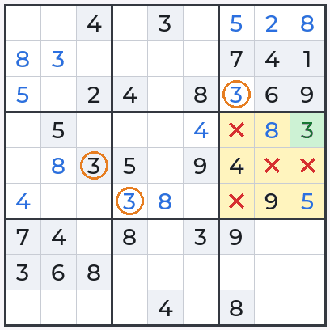

<!-- Written by tools/walkthrough.py non-consecutive: edit the script, not this page. -->
# Non-Consecutive, step 15: the 3 in box 6

**Step 15 of 55** · [← Step 14](step-14.md) · [All steps](../non-consecutive.md#the-whole-puzzle-step-by-step) · [Step 16 →](step-16.md)

Box 6 needs a 3. r4c7: column 7 has one (r3c7). r5c8 and r5c9: row 5 has one (r5c3). r6c7: row 6 has one (r6c4). Only **r4c9** is left: **r4c9 = 3**.

**Step 15 of 55** · [← Step 14](step-14.md) · [All steps](../non-consecutive.md#the-whole-puzzle-step-by-step) · [Step 16 →](step-16.md)
