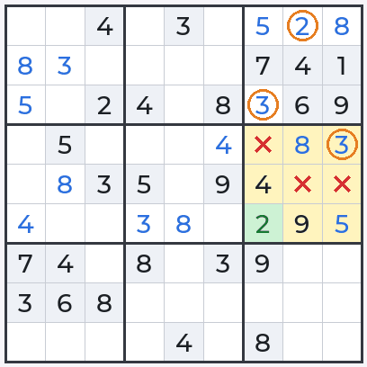

<!-- Written by tools/walkthrough.py non-consecutive: edit the script, not this page. -->
# Non-Consecutive, step 16: the 2 in box 6

**Step 16 of 55** · [← Step 15](step-15.md) · [All steps](../non-consecutive.md#the-whole-puzzle-step-by-step) · [Step 17 →](step-17.md)

Box 6 needs a 2. r5c8: column 8 has one (r1c8). r4c7: it has no bar to the 3 in r3c7, so it isn't 2 or 4. r5c9: it has no bar to the 3 in r4c9, so it isn't 2 or 4. Only **r6c7** is left: **r6c7 = 2**.

**Step 16 of 55** · [← Step 15](step-15.md) · [All steps](../non-consecutive.md#the-whole-puzzle-step-by-step) · [Step 17 →](step-17.md)
