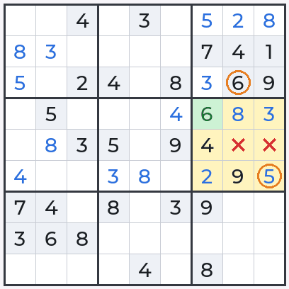

<!-- Written by tools/walkthrough.py non-consecutive: edit the script, not this page. -->
# Non-Consecutive, step 17: the 6 in box 6

**Step 17 of 55** · [← Step 16](step-16.md) · [All steps](../non-consecutive.md#the-whole-puzzle-step-by-step) · [Step 18 →](step-18.md)

Box 6 needs a 6. r5c8: column 8 has one (r3c8). r5c9: it has no bar to the 5 in r6c9, so it isn't 4 or 6. Only **r4c7** is left: **r4c7 = 6**.

**Step 17 of 55** · [← Step 16](step-16.md) · [All steps](../non-consecutive.md#the-whole-puzzle-step-by-step) · [Step 18 →](step-18.md)
