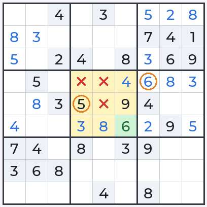

<!-- Written by tools/walkthrough.py non-consecutive: edit the script, not this page. -->
# Non-Consecutive, step 18: the 6 in box 5

**Step 18 of 55** · [← Step 17](step-17.md) · [All steps](../non-consecutive.md#the-whole-puzzle-step-by-step) · [Step 19 →](step-19.md)

Box 5 needs a 6. r4c4 and r4c5: row 4 has one (r4c7). r5c5: it has no bar to the 5 in r5c4, so it isn't 4 or 6. Only **r6c6** is left: **r6c6 = 6**.

**Step 18 of 55** · [← Step 17](step-17.md) · [All steps](../non-consecutive.md#the-whole-puzzle-step-by-step) · [Step 19 →](step-19.md)
