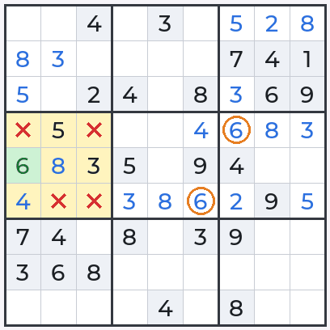

<!-- Written by tools/walkthrough.py non-consecutive: edit the script, not this page. -->
# Non-Consecutive, step 19: the 6 in box 4

**Step 19 of 55** · [← Step 18](step-18.md) · [All steps](../non-consecutive.md#the-whole-puzzle-step-by-step) · [Step 20 →](step-20.md)

Box 4 needs a 6. r4c1 and r4c3: row 4 has one (r4c7). r6c2 and r6c3: row 6 has one (r6c6). Only **r5c1** is left: **r5c1 = 6**.

**Step 19 of 55** · [← Step 18](step-18.md) · [All steps](../non-consecutive.md#the-whole-puzzle-step-by-step) · [Step 20 →](step-20.md)
