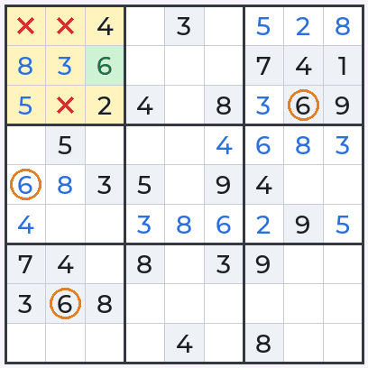

<!-- Written by tools/walkthrough.py non-consecutive: edit the script, not this page. -->
# Non-Consecutive, step 20: the 6 in box 1

**Step 20 of 55** · [← Step 19](step-19.md) · [All steps](../non-consecutive.md#the-whole-puzzle-step-by-step) · [Step 21 →](step-21.md)

Box 1 needs a 6. r1c1: column 1 has one (r5c1). r1c2: column 2 has one (r8c2). r3c2: row 3 has one (r3c8). Only **r2c3** is left: **r2c3 = 6**.

**Step 20 of 55** · [← Step 19](step-19.md) · [All steps](../non-consecutive.md#the-whole-puzzle-step-by-step) · [Step 21 →](step-21.md)
