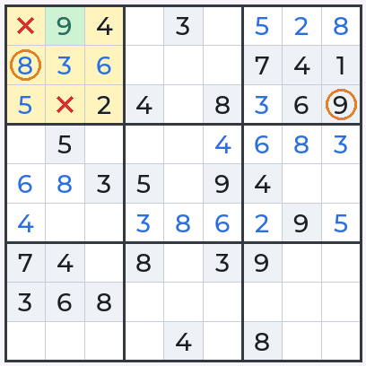

<!-- Written by tools/walkthrough.py non-consecutive: edit the script, not this page. -->
# Non-Consecutive, step 21: the 9 in box 1

**Step 21 of 55** · [← Step 20](step-20.md) · [All steps](../non-consecutive.md#the-whole-puzzle-step-by-step) · [Step 22 →](step-22.md)

Box 1 needs a 9. r3c2: row 3 has one (r3c9). r1c1: it has no bar to the 8 in r2c1, so it isn't 7 or 9. Only **r1c2** is left: **r1c2 = 9**.

**Step 21 of 55** · [← Step 20](step-20.md) · [All steps](../non-consecutive.md#the-whole-puzzle-step-by-step) · [Step 22 →](step-22.md)
