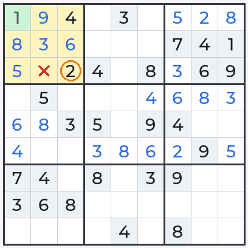

<!-- Written by tools/walkthrough.py non-consecutive: edit the script, not this page. -->
# Non-Consecutive, step 22: the 1 in box 1

**Step 22 of 55** · [← Step 21](step-21.md) · [All steps](../non-consecutive.md#the-whole-puzzle-step-by-step) · [Step 23 →](step-23.md)

Box 1 needs a 1. r3c2: it has no bar to the 2 in r3c3, so it isn't 1 or 3. Only **r1c1** is left: **r1c1 = 1**.

**Step 22 of 55** · [← Step 21](step-21.md) · [All steps](../non-consecutive.md#the-whole-puzzle-step-by-step) · [Step 23 →](step-23.md)
