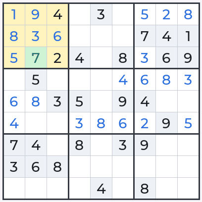

<!-- Written by tools/walkthrough.py non-consecutive: edit the script, not this page. -->
# Non-Consecutive, step 23: the 7 in box 1

**Step 23 of 55** · [← Step 22](step-22.md) · [All steps](../non-consecutive.md#the-whole-puzzle-step-by-step) · [Step 24 →](step-24.md)

Box 1 needs a 7, and r3c2 is its last empty cell: **r3c2 = 7**.

**Step 23 of 55** · [← Step 22](step-22.md) · [All steps](../non-consecutive.md#the-whole-puzzle-step-by-step) · [Step 24 →](step-24.md)
