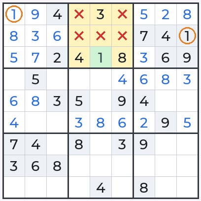

<!-- Written by tools/walkthrough.py non-consecutive: edit the script, not this page. -->
# Non-Consecutive, step 24: the 1 in box 2

**Step 24 of 55** · [← Step 23](step-23.md) · [All steps](../non-consecutive.md#the-whole-puzzle-step-by-step) · [Step 25 →](step-25.md)

Box 2 needs a 1. r1c4 and r1c6: row 1 has one (r1c1). r2c4, r2c5 and r2c6: row 2 has one (r2c9). Only **r3c5** is left: **r3c5 = 1**.

**Step 24 of 55** · [← Step 23](step-23.md) · [All steps](../non-consecutive.md#the-whole-puzzle-step-by-step) · [Step 25 →](step-25.md)
