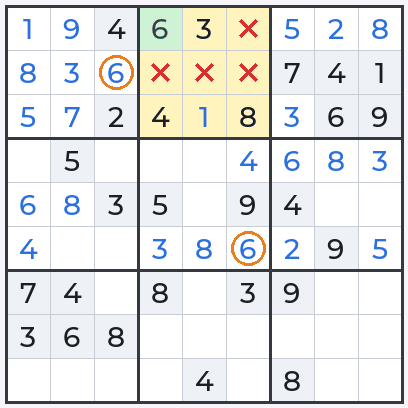

<!-- Written by tools/walkthrough.py non-consecutive: edit the script, not this page. -->
# Non-Consecutive, step 25: the 6 in box 2

**Step 25 of 55** · [← Step 24](step-24.md) · [All steps](../non-consecutive.md#the-whole-puzzle-step-by-step) · [Step 26 →](step-26.md)

Box 2 needs a 6. r1c6: column 6 has one (r6c6). r2c4, r2c5 and r2c6: row 2 has one (r2c3). Only **r1c4** is left: **r1c4 = 6**.

**Step 25 of 55** · [← Step 24](step-24.md) · [All steps](../non-consecutive.md#the-whole-puzzle-step-by-step) · [Step 26 →](step-26.md)
