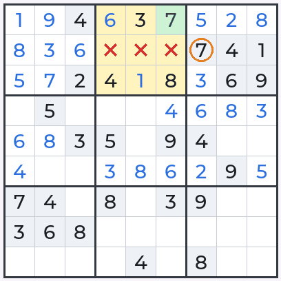

<!-- Written by tools/walkthrough.py non-consecutive: edit the script, not this page. -->
# Non-Consecutive, step 26: the 7 in box 2

**Step 26 of 55** · [← Step 25](step-25.md) · [All steps](../non-consecutive.md#the-whole-puzzle-step-by-step) · [Step 27 →](step-27.md)

Box 2 needs a 7. r2c4, r2c5 and r2c6: row 2 has one (r2c7). Only **r1c6** is left: **r1c6 = 7**.

**Step 26 of 55** · [← Step 25](step-25.md) · [All steps](../non-consecutive.md#the-whole-puzzle-step-by-step) · [Step 27 →](step-27.md)
