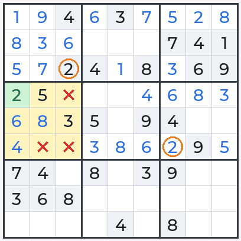

<!-- Written by tools/walkthrough.py non-consecutive: edit the script, not this page. -->
# Non-Consecutive, step 27: the 2 in box 4

**Step 27 of 55** · [← Step 26](step-26.md) · [All steps](../non-consecutive.md#the-whole-puzzle-step-by-step) · [Step 28 →](step-28.md)

Box 4 needs a 2. r4c3: column 3 has one (r3c3). r6c2 and r6c3: row 6 has one (r6c7). Only **r4c1** is left: **r4c1 = 2**.

**Step 27 of 55** · [← Step 26](step-26.md) · [All steps](../non-consecutive.md#the-whole-puzzle-step-by-step) · [Step 28 →](step-28.md)
