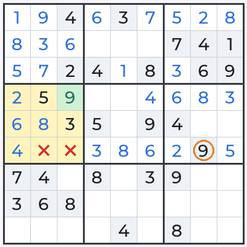

<!-- Written by tools/walkthrough.py non-consecutive: edit the script, not this page. -->
# Non-Consecutive, step 28: the 9 in box 4

**Step 28 of 55** · [← Step 27](step-27.md) · [All steps](../non-consecutive.md#the-whole-puzzle-step-by-step) · [Step 29 →](step-29.md)

Box 4 needs a 9. r6c2 and r6c3: row 6 has one (r6c8). Only **r4c3** is left: **r4c3 = 9**.

**Step 28 of 55** · [← Step 27](step-27.md) · [All steps](../non-consecutive.md#the-whole-puzzle-step-by-step) · [Step 29 →](step-29.md)
