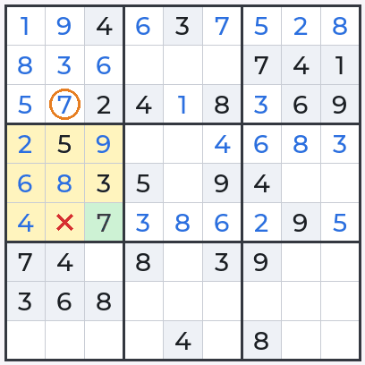

<!-- Written by tools/walkthrough.py non-consecutive: edit the script, not this page. -->
# Non-Consecutive, step 29: the 7 in box 4

**Step 29 of 55** · [← Step 28](step-28.md) · [All steps](../non-consecutive.md#the-whole-puzzle-step-by-step) · [Step 30 →](step-30.md)

Box 4 needs a 7. r6c2: column 2 has one (r3c2). Only **r6c3** is left: **r6c3 = 7**.

**Step 29 of 55** · [← Step 28](step-28.md) · [All steps](../non-consecutive.md#the-whole-puzzle-step-by-step) · [Step 30 →](step-30.md)
