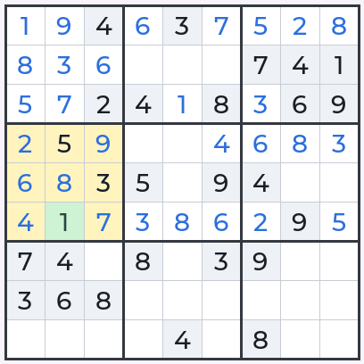

<!-- Written by tools/walkthrough.py non-consecutive: edit the script, not this page. -->
# Non-Consecutive, step 30: the 1 in box 4

**Step 30 of 55** · [← Step 29](step-29.md) · [All steps](../non-consecutive.md#the-whole-puzzle-step-by-step) · [Step 31 →](step-31.md)

Box 4 needs a 1, and r6c2 is its last empty cell: **r6c2 = 1**.

**Step 30 of 55** · [← Step 29](step-29.md) · [All steps](../non-consecutive.md#the-whole-puzzle-step-by-step) · [Step 31 →](step-31.md)
