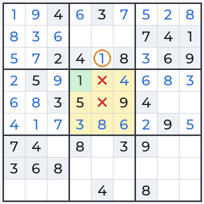

<!-- Written by tools/walkthrough.py non-consecutive: edit the script, not this page. -->
# Non-Consecutive, step 31: the 1 in box 5

**Step 31 of 55** · [← Step 30](step-30.md) · [All steps](../non-consecutive.md#the-whole-puzzle-step-by-step) · [Step 32 →](step-32.md)

Box 5 needs a 1. r4c5 and r5c5: column 5 has one (r3c5). Only **r4c4** is left: **r4c4 = 1**.

**Step 31 of 55** · [← Step 30](step-30.md) · [All steps](../non-consecutive.md#the-whole-puzzle-step-by-step) · [Step 32 →](step-32.md)
