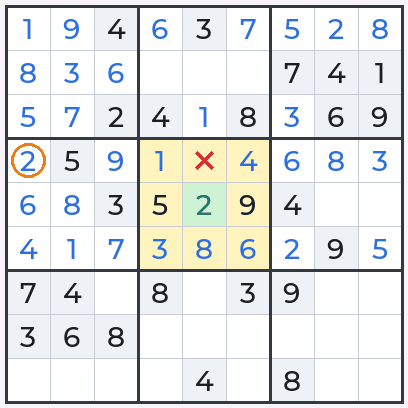

<!-- Written by tools/walkthrough.py non-consecutive: edit the script, not this page. -->
# Non-Consecutive, step 32: the 2 in box 5

**Step 32 of 55** · [← Step 31](step-31.md) · [All steps](../non-consecutive.md#the-whole-puzzle-step-by-step) · [Step 33 →](step-33.md)

Box 5 needs a 2. r4c5: row 4 has one (r4c1). Only **r5c5** is left: **r5c5 = 2**.

**Step 32 of 55** · [← Step 31](step-31.md) · [All steps](../non-consecutive.md#the-whole-puzzle-step-by-step) · [Step 33 →](step-33.md)
