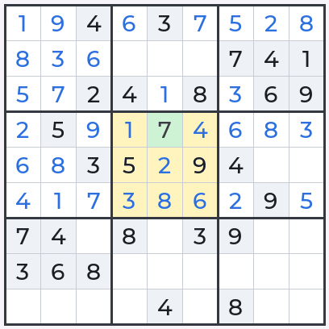

<!-- Written by tools/walkthrough.py non-consecutive: edit the script, not this page. -->
# Non-Consecutive, step 33: the 7 in box 5

**Step 33 of 55** · [← Step 32](step-32.md) · [All steps](../non-consecutive.md#the-whole-puzzle-step-by-step) · [Step 34 →](step-34.md)

Box 5 needs a 7, and r4c5 is its last empty cell: **r4c5 = 7**.

**Step 33 of 55** · [← Step 32](step-32.md) · [All steps](../non-consecutive.md#the-whole-puzzle-step-by-step) · [Step 34 →](step-34.md)
