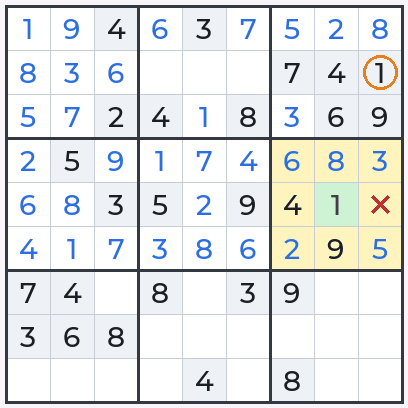

<!-- Written by tools/walkthrough.py non-consecutive: edit the script, not this page. -->
# Non-Consecutive, step 34: the 1 in box 6

**Step 34 of 55** · [← Step 33](step-33.md) · [All steps](../non-consecutive.md#the-whole-puzzle-step-by-step) · [Step 35 →](step-35.md)

Box 6 needs a 1. r5c9: column 9 has one (r2c9). Only **r5c8** is left: **r5c8 = 1**.

**Step 34 of 55** · [← Step 33](step-33.md) · [All steps](../non-consecutive.md#the-whole-puzzle-step-by-step) · [Step 35 →](step-35.md)
