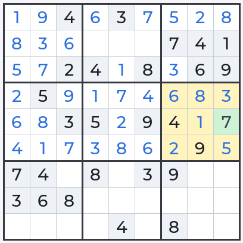

<!-- Written by tools/walkthrough.py non-consecutive: edit the script, not this page. -->
# Non-Consecutive, step 35: the 7 in box 6

**Step 35 of 55** · [← Step 34](step-34.md) · [All steps](../non-consecutive.md#the-whole-puzzle-step-by-step) · [Step 36 →](step-36.md)

Box 6 needs a 7, and r5c9 is its last empty cell: **r5c9 = 7**.

**Step 35 of 55** · [← Step 34](step-34.md) · [All steps](../non-consecutive.md#the-whole-puzzle-step-by-step) · [Step 36 →](step-36.md)
