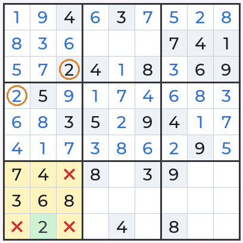

<!-- Written by tools/walkthrough.py non-consecutive: edit the script, not this page. -->
# Non-Consecutive, step 36: the 2 in box 7

**Step 36 of 55** · [← Step 35](step-35.md) · [All steps](../non-consecutive.md#the-whole-puzzle-step-by-step) · [Step 37 →](step-37.md)

Box 7 needs a 2. r7c3 and r9c3: column 3 has one (r3c3). r9c1: column 1 has one (r4c1). Only **r9c2** is left: **r9c2 = 2**.

**Step 36 of 55** · [← Step 35](step-35.md) · [All steps](../non-consecutive.md#the-whole-puzzle-step-by-step) · [Step 37 →](step-37.md)
