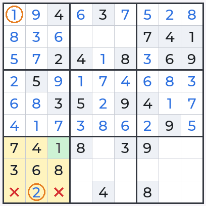

<!-- Written by tools/walkthrough.py non-consecutive: edit the script, not this page. -->
# Non-Consecutive, step 37: the 1 in box 7

**Step 37 of 55** · [← Step 36](step-36.md) · [All steps](../non-consecutive.md#the-whole-puzzle-step-by-step) · [Step 38 →](step-38.md)

Box 7 needs a 1. r9c1: column 1 has one (r1c1). r9c3: it has no bar to the 2 in r9c2, so it isn't 1 or 3. Only **r7c3** is left: **r7c3 = 1**.

**Step 37 of 55** · [← Step 36](step-36.md) · [All steps](../non-consecutive.md#the-whole-puzzle-step-by-step) · [Step 38 →](step-38.md)
