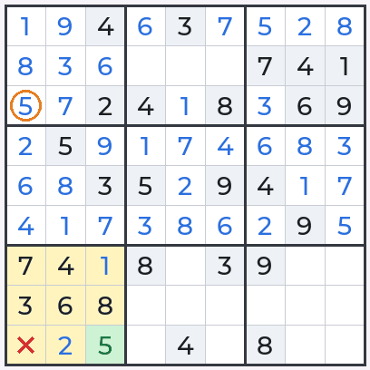

<!-- Written by tools/walkthrough.py non-consecutive: edit the script, not this page. -->
# Non-Consecutive, step 38: the 5 in box 7

**Step 38 of 55** · [← Step 37](step-37.md) · [All steps](../non-consecutive.md#the-whole-puzzle-step-by-step) · [Step 39 →](step-39.md)

Box 7 needs a 5. r9c1: column 1 has one (r3c1). Only **r9c3** is left: **r9c3 = 5**.

**Step 38 of 55** · [← Step 37](step-37.md) · [All steps](../non-consecutive.md#the-whole-puzzle-step-by-step) · [Step 39 →](step-39.md)
