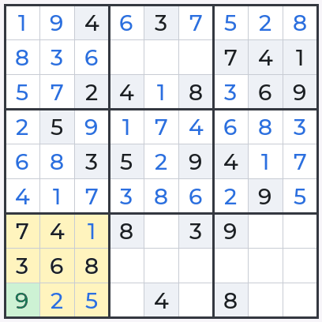

<!-- Written by tools/walkthrough.py non-consecutive: edit the script, not this page. -->
# Non-Consecutive, step 39: the 9 in box 7

**Step 39 of 55** · [← Step 38](step-38.md) · [All steps](../non-consecutive.md#the-whole-puzzle-step-by-step) · [Step 40 →](step-40.md)

Box 7 needs a 9, and r9c1 is its last empty cell: **r9c1 = 9**.

**Step 39 of 55** · [← Step 38](step-38.md) · [All steps](../non-consecutive.md#the-whole-puzzle-step-by-step) · [Step 40 →](step-40.md)
