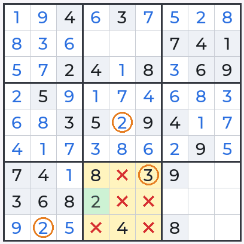

<!-- Written by tools/walkthrough.py non-consecutive: edit the script, not this page. -->
# Non-Consecutive, step 40: the 2 in box 8

**Step 40 of 55** · [← Step 39](step-39.md) · [All steps](../non-consecutive.md#the-whole-puzzle-step-by-step) · [Step 41 →](step-41.md)

Box 8 needs a 2. r7c5 and r8c5: column 5 has one (r5c5). r9c4 and r9c6: row 9 has one (r9c2). r8c6: it has no bar to the 3 in r7c6, so it isn't 2 or 4. Only **r8c4** is left: **r8c4 = 2**.

**Step 40 of 55** · [← Step 39](step-39.md) · [All steps](../non-consecutive.md#the-whole-puzzle-step-by-step) · [Step 41 →](step-41.md)
