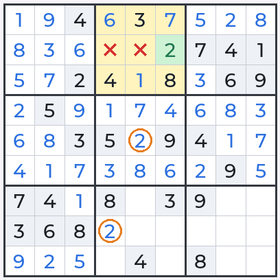

<!-- Written by tools/walkthrough.py non-consecutive: edit the script, not this page. -->
# Non-Consecutive, step 41: the 2 in box 2

**Step 41 of 55** · [← Step 40](step-40.md) · [All steps](../non-consecutive.md#the-whole-puzzle-step-by-step) · [Step 42 →](step-42.md)

Box 2 needs a 2. r2c4: column 4 has one (r8c4). r2c5: column 5 has one (r5c5). Only **r2c6** is left: **r2c6 = 2**.

**Step 41 of 55** · [← Step 40](step-40.md) · [All steps](../non-consecutive.md#the-whole-puzzle-step-by-step) · [Step 42 →](step-42.md)
